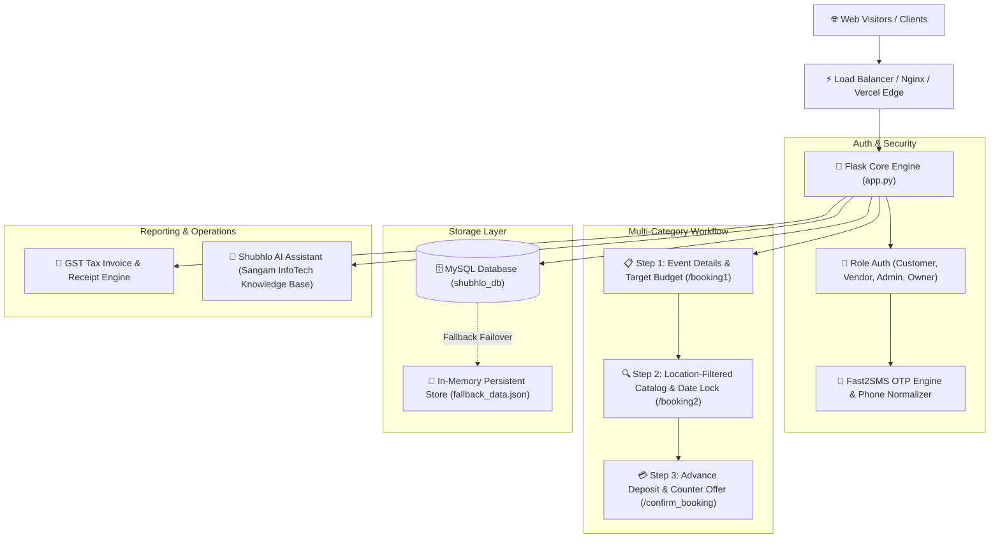

<p align="center">
  
</p>

<p align="center">
  <a href="https://github.com/sibbu9599/Shubhlo">
    
  </a>
</p>

<p align="center">
  
  
  
  
  
  
</p>

---

<p align="center">
  
  <br>
  <strong>Official Corporate Brand: Sangam InfoTech Pvt. Ltd.</strong>
</p>

---

## 🌟 Executive Overview

**Shubhlo (शुभलो)** is India’s premium full-stack event planning, venue reservation, and wedding vendor marketplace platform developed, operated, and maintained by **Sangam InfoTech Pvt. Ltd.**

Designed with an elegant, responsive UI and an enterprise-grade backend architecture, Shubhlo connects event hosts with **18 verified event services categories** across Madhya Pradesh and all across India. With real-time date availability blocking, dynamic token payments, custom counter-offers, dispute resolution guarantees, and live Fast2SMS mobile OTP verification, Shubhlo sets the new benchmark for wedding and corporate event planning.

---

## 💎 Key Highlights & Architectural Strengths

```
┌────────────────────────────────────────────────────────────────────────┐
│                        SHUBHLO PLATFORM ENGINE                         │
├───────────────────────┬────────────────────────┬───────────────────────┤
│ 👤 Customer Portal    │ 🏪 Vendor Hub          │ 👑 Master Admin/Owner │
│ • 18 Service Catalog  │ • Live Date Blocking   │ • System Pause Switch │
│ • Target Budget Math  │ • Price & MOQ Control  │ • Anti-Fake KYC Audit │
│ • GST Tax Invoices    │ • Custom Counter Offers│ • SMS Gateway Control │
│ • Dispute Protection  │ • Earnings & Ledger    │ • Permanent Wipe Tool │
└───────────────────────┴────────────────────────┴───────────────────────┘
```

- 🛡️ **Zero-Fake Data Guarantee**: No mock or pre-populated placeholder bookings for new users. Authentic database records ensure 100% data integrity.
- 📱 **Mobile & Email Fast2SMS OTP Gateway**: Seamless forgot-password and verification engine supporting 10-digit, `+91`, and leading-zero phone formats with live SMS dispatch via **Fast2SMS**.
- 🏰 **18 Complete Service Categories in 1-Click**: From Grand Marriage Gardens and Royal Shahi Savari to Live Pyrotechnics and Punjabi Dhol Bands.
- 🤝 **Transparent Counter-Offer Engine**: Vendors and customers can negotiate event budgets dynamically with complete audit trails.
- 🚀 **Dual Deployment Ready**: Pre-configured for both **Vercel Serverless** (`vercel.json`, `api/index.py`) and **cPanel / Ubuntu VPS** (`passenger_wsgi.py`, `Procfile`, `gunicorn`).

---

## 🎪 18 Event Service Categories

| Category | Service Name | Technical Key | Highlights |
| :---: | :--- | :--- | :--- |
| 🏰 | **Venue / Marriage Garden** | `venue` | AC Banquet Halls, Open Lawns, Resort Bookings |
| 🍽️ | **Catering & Buffet** | `catering` | Multi-Cuisine, Live Food Counters, Sweet Stalls |
| 🎵 | **DJ Sound & Laser Lights** | `dj` | Heavy Bass JBL setups, Fog screens, Dance floors |
| 📸 | **Photography & Cinematic Films** | `photography` | 4K Wedding Cinema, Pre-Wedding Shoots, Drone Films |
| 💄 | **Bridal Makeup & Beauty Studio** | `makeup` | HD Airbrush, Party Makeovers, Hairstyling |
| 🚗 | **Luxury Transport & Vintage Cars** | `transport` | Audi/BMW bridal entries, Guest coach fleets |
| 🎈 | **Stage Decoration & Floral Art** | `decoration` | Theme floral arches, Mandap styling, LED backdrops |
| 🎂 | **Birthday Celebrations** | `birthday` | Cartoon mascots, Balloon themes, Magic shows |
| 🛡️ | **Bouncers & Event Security** | `security_guard` | VIP Bodyguards, Female bouncers, Metal detectors |
| 👑 | **Shahi Savari & Royal Buggy** | `shahi_savari` | Traditional horses, Decorated Royal Rath, Elephant entries |
| 💌 | **Digital & Wedding Invitation Cards** | `invitation_card` | Box cards, Video E-Invites, Gold foil cards |
| ⛺ | **Tentage & German Waterproof Hangers** | `tent_lighting` | Pagoda tents, Chandeliers, Carpet pathways |
| 🎺 | **Band Baaja & Punjabi Dhol** | `band_dhol` | Brass bands, Dhol players, Tasha groups |
| 🎆 | **Cold Pyro & Aerial Fireworks** | `fireworks` | Confetti blasts, Cold sparks entries, Sky shots |
| 🎤 | **Anchor, Emcee & Choreographers** | `anchor_choreographer` | Sangeet choreo, Celebrity anchors, Flashmobs |
| 🌿 | **Bridal Mehendi & Organic Henna** | `mehendi` | Rajasthani Marwari, Arabic, Portrait Mehendi |
| 👳 | **Royal Safa & Turban Styling** | `safa_turban` | Jodhpuri safa, Barati pagri tying, Silk stoles |
| 🌼 | **Haldi & Floral Jewelry Setup** | `haldi_setup` | Marigold yellow decor, Flower jewelry, Water fountains |

---

## 🏛️ System Architecture Flow



---

## 🚀 Hostinger Deployment Guide (Official & Recommended)

### Option A: Hostinger VPS (1-Click Automated Setup)

For the best commercial performance, run Shubhlo on Hostinger KVM VPS:

```bash
# 1. SSH into your Hostinger VPS
ssh root@YOUR_HOSTINGER_SERVER_IP

# 2. Run the 1-Click Setup Script directly:
curl -sSL https://raw.githubusercontent.com/sibbu9599/Shubhlo/main/setup_hostinger_vps.sh | bash

# 3. Setup your free SSL certificate:
sudo certbot --nginx -d shubhlo.in -d www.shubhlo.in
```

The script automatically configures:
- Python 3 virtual environment (`/var/www/shubhlo/venv`)
- Production Gunicorn WSGI daemon (`shubhlo.service`)
- High-performance Nginx reverse proxy (`nginx_shubhlo.conf`)
- Static assets & uploads caching for lightning-fast speeds

---

### Option B: Hostinger Web / Cloud Hosting (hPanel)

1. Open **Hostinger hPanel > Databases > MySQL Databases** and create `shubhlo_db`.
2. Open **phpMyAdmin**, click on `shubhlo_db`, and **Import** [`schema.sql`](schema.sql).
3. Open **Websites > Manage > Advanced > Python** in hPanel:
   - Python Version: `3.10` or `3.11`
   - Application Root: `shubhlo` (or `public_html`)
   - Application Startup File: `passenger_wsgi.py`
   - Application Entry Point: `application`
4. Open **File Manager**, upload and extract [`shubhlo_production_deploy.zip`](shubhlo_production_deploy.zip).
5. Add your database credentials and secret key to `.env`.
6. Click **Run Pip Install** on `requirements.txt` and click **Restart App**!

---

### Option C: Legacy Vercel Serverless (Optional Testing)

If testing on Vercel without a persistent server, import [`vercel.json`](vercel.json) and [`api/index.py`](api/index.py). Note: For commercial live use, Hostinger VPS or hPanel with persistent MySQL is recommended.

---

## 🧪 Automated Testing & Quality Assurance

Shubhlo includes a comprehensive test suite covering cross-role duplicate prevention, empty dashboard integrity, date availability locking, and owner account deletion:

```bash
# Run the Master End-to-End Suite
python test_master_end_to_end_suite.py
```

Result:
```text
Ran 7 tests in 1.46s
OK (All 7/7 Master Tests Passed)
✓ Customer Cases: Passed
✓ Vendor Gate Cases: Passed
✓ Master Owner Controls: Passed
```

---

## 📁 Repository Directory Map

```text
Shubhlo/
├── app.py                      # Core Flask Controller (6,300+ LOC)
├── vercel.json                 # Vercel Serverless Routing & Python Runtime Config
├── passenger_wsgi.py           # Phusion Passenger Gateway for cPanel / CloudLinux
├── Procfile                    # Production Process Declaration for Gunicorn
├── requirements.txt            # Production Python Dependencies
├── schema.sql                  # Full MySQL Production Database Schema (UTF8MB4)
├── database.sql                # Supplementary Relational Table Definitions
├── .env.example                # Template for Environment Configuration
├── README.md                   # Animated Master Documentation
├── api/
│   └── index.py                # Serverless Entry Point for Vercel Functions
├── static/
│   ├── image/
│   │   ├── sangam_infotech_logo.png             # Official Brand Logo
│   │   ├── sangam_infotech_logo_transparent.png # Dark/Alpha Mode Logo
│   │   └── sangam_infotech_logo_white.png       # Inverted White Logo
│   ├── master.css              # Global Master Design System & Palettes
│   ├── booking2.css            # Interactive Multi-Category Catalog Styles
│   ├── booking2.js             # Client-side Budget Math & Date Locking
│   └── chatbot.js              # Shubhlo AI Event Consultant Interface
└── templates/
    ├── home.html               # Flagship Landing Page
    ├── booking1.html           # Step 1: Event Details & Budget Form
    ├── booking2.html           # Step 2: 18-Category Vendor Catalog Grid
    ├── confirm_booking.html    # Step 3: Token Deposit & Counter Offer
    ├── invoice.html            # GST Tax Invoice & Platform Receipt
    ├── vendor_dashboard.html   # Real-Time Vendor Management Center
    ├── owner_dashboard.html    # Master Admin & Owner Control Panel
    └── terms.html              # Official Terms of Service & Liability Shield
```

---

## 🏢 Corporate Ownership & Legal Information

<p align="center">
  <strong>Shubhlo (शुभलो)</strong> is proudly owned, managed, and operated by:<br>
  <strong>Sangam InfoTech Pvt. Ltd.</strong><br>
  📧 Support: <a href="mailto:support@shubhlo.com">support@shubhlo.com</a> &nbsp;|&nbsp; 📞 Helpline: +91 7067883131<br>
  🌐 Head Office: Madhya Pradesh, India
</p>

<p align="center">
  
</p>
